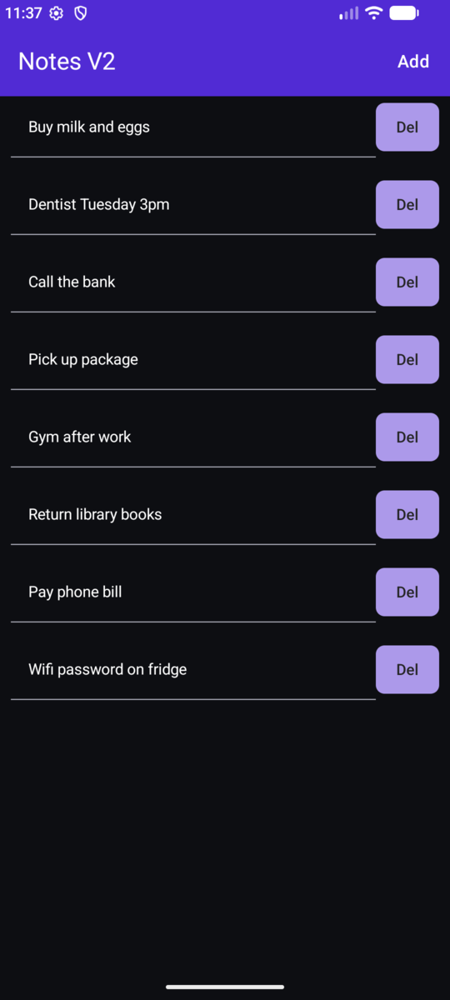
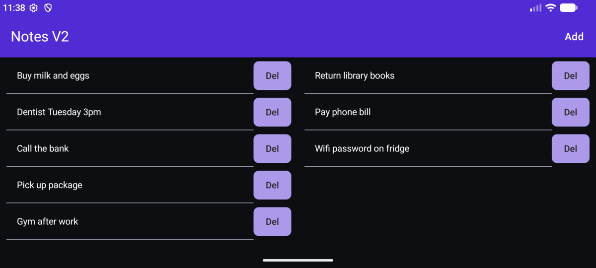

# Notes V2

A simple Android notes app, built with Kotlin and Jetpack Compose.

It's a rewrite of my original [MyNotes](https://youtu.be/wtfTywKmSUk) app, which was made with .NET MAUI.

<p>
  
  
</p>

## Features

- **Add** a note from the title bar. The new note scrolls into view and the cursor goes straight into it.
- **Autosave:** notes are saved as you type, so there's no save button.
- **Del** removes a note, and **Undo** brings it back.
- **Landscape layout:** turn the phone sideways to see notes 1–5 on the left and the rest on the right. The right side scrolls if you have more than 10.
- **Light and dark mode.**

## Build and run

1. Open the project in Android Studio.
2. Press **Run**.

Or build an APK from the command line:

```sh
./gradlew assembleDebug
```

The APK ends up in `app/build/outputs/apk/debug/`.

Requires Android 7.0 (API 24) or newer.

## Changes from the original MAUI app

- Removed the Save and Load buttons, because the app saves as you type
- Added Undo after deleting a note
- New notes scroll into view and get focus
- All notes are stored together as one list
- Notes stay put when the phone rotates, and landscape gets a two-column layout
- Add moved into the title bar
